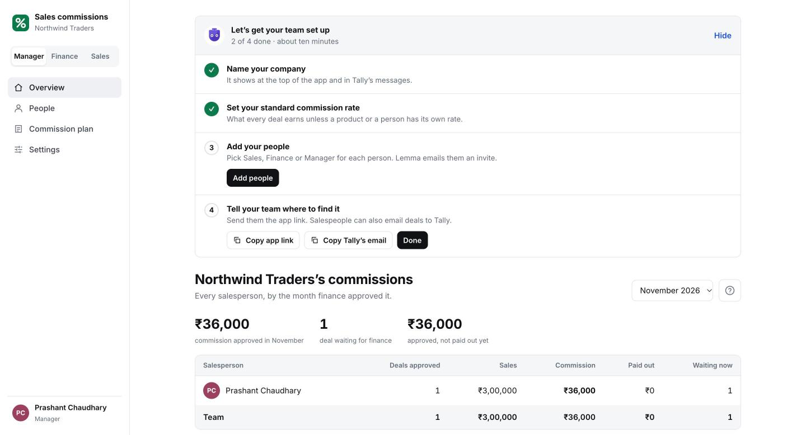
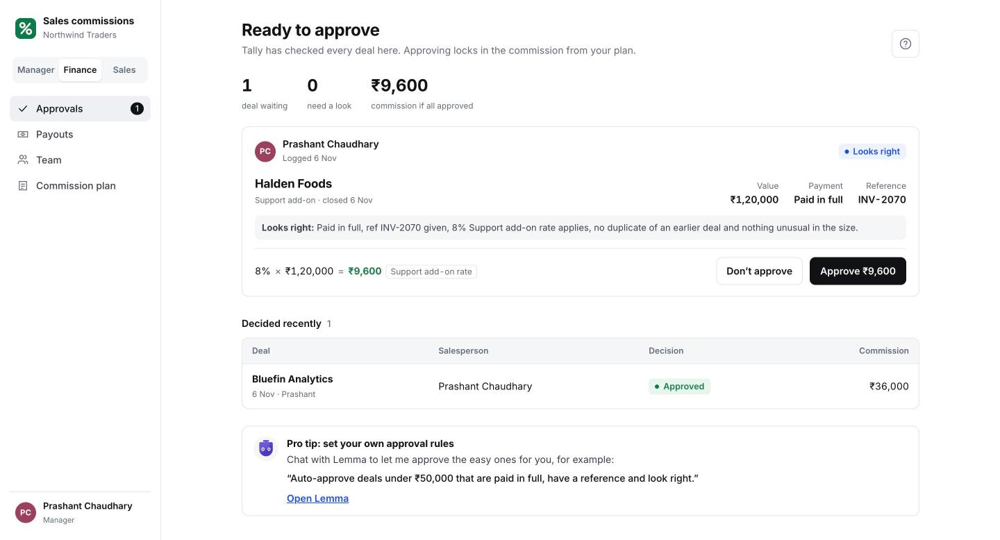
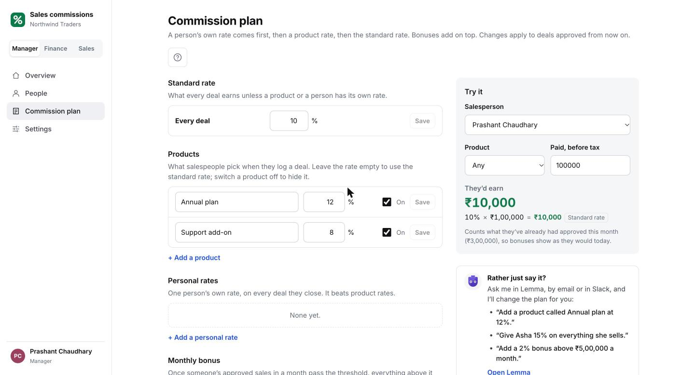
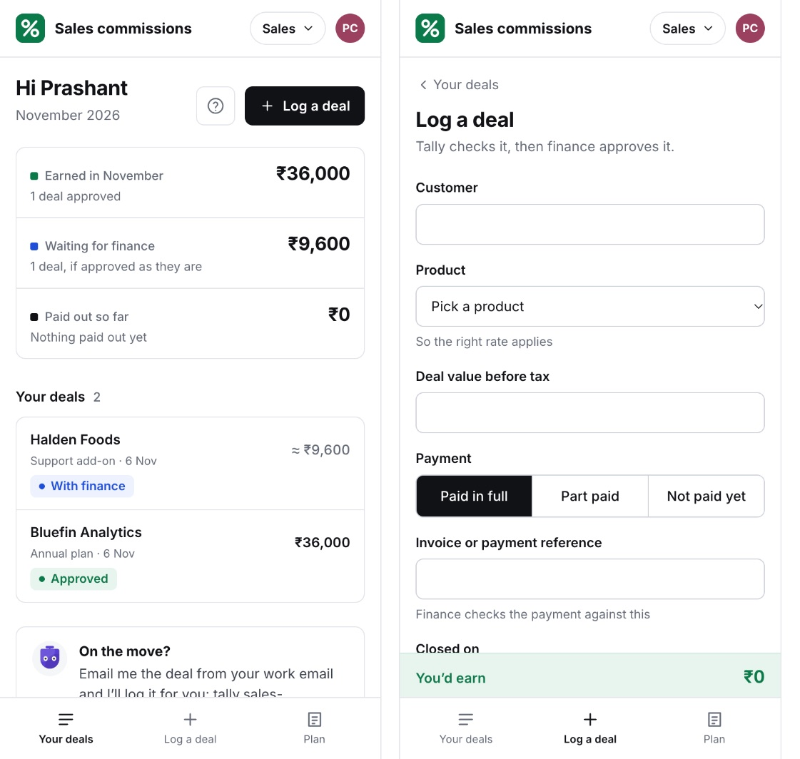

<h1 align="center">Sales commissions</h1>

<p align="center">
  <strong>Salespeople log deals. Tally checks them. Finance approves. Everyone knows what they’ve earned.</strong>
</p>

<p align="center">
  One app for your whole team, with an AI teammate called Tally that checks every deal,<br />
  works out the commission from your plan, and keeps everyone posted.
</p>

<p align="center">
  <a href="https://lemma.work/import/github/wineforyourplate/sales-commissions">
    
  </a>
</p>

<p align="center"></p>

---

## One app, three views

Everyone opens the same link. The app checks who’s signed in and shows them their team’s screens.

| Team | What they see |
| --- | --- |
| **Sales** | Their own deals and commission. They log a deal in a minute and see what it will earn as they type. |
| **Finance** | Every deal waiting for approval, already checked by Tally. Approve, or say why not. Then mark the month paid out. |
| **Manager** | Everything: everyone’s commission, the people, the commission plan and settings. Managers can switch to the Finance or Sales view at any time. |

Nobody ever acts as someone else. A deal is logged under the person who logged it, and an approval carries the name of the person who approved it.

| Finance approves | The commission plan | On a phone |
| --- | --- | --- |
|  |  |  |

## Install

Click **Install & Remix on Lemma** above and pick the organisation to install it in. The template arrives empty, with no sample data.

Or install it from the command line:

```bash
git clone https://github.com/wineforyourplate/sales-commissions && cd sales-commissions
lemma pods create "Sales commissions"
lemma --pod <the-new-pod-id> pods import .
```

Then open the **Sales commissions** app in your new space. You’re the manager.

## Set up (about ten minutes)

When you first open the app, Tally introduces itself and puts four steps on your home screen:

1. **Name your company** and pick your currency.
2. **Set your standard commission rate.** Add products, personal rates and a monthly bonus under **Commission plan** if you need them.
3. **Add your people.** Type their work email and pick **Sales**, **Finance** or **Manager**. Lemma emails them an invite.
4. **Tell your team where to find it.** Copy the app link and Tally’s email address and send them round.

Each person gets Tally’s introduction the first time they open the app, on any device.

## Who sees what

The app uses the roles in your Lemma space, so there’s nothing else to keep in step:

- **Managers** are the space’s **Admins** (and Editors). They see everything. Admins can also add people. An Editor can change any part of the space, including the app itself, so only make managers Editors.
- **Finance** are members with the **Finance** role.
- **Sales** are everyone else in the space.

The app also locks the money down in Lemma itself, not only on screen. Only Finance and managers can approve a deal or mark a payout, and only managers can change the plan. Salespeople can read the plan and the commission records, but can’t change either.

## Changing the commission plan

Managers have two ways:

- **In the app:** open **Commission plan**. A person’s own rate comes first, then a product rate, then the standard rate. A monthly bonus adds an extra rate on sales above a threshold. **Try it** shows what a deal would earn before you save.
- **By asking Tally**, in Lemma, by email or in Slack: *“Add a product called Annual plan at 12%”*, *“Give Asha 15% on everything she sells”*, *“Add a 2% bonus above ₹5,00,000 a month”*.

Changes apply to deals approved from then on. Deals already approved keep what they earned.

## How people reach Tally

Tally has its own email address, shown under **Settings**. A salesperson can email it a deal from the address they sign in with, for example *“Closed Bluefin, Annual plan, 3,00,000 before tax, paid in full, INV-2061”*. Tally logs it under them and replies with what it should earn.

You can also give Tally a channel your team already uses. In your Lemma space, open **About → Channels**:

| Channel | What it takes |
| --- | --- |
| **WhatsApp** | A number your team can message. Ready in a few minutes. |
| **Telegram** | Tally’s own bot. About a minute. |
| **Slack** | Add Lemma to your Slack, give Tally its own bot, then invite it to your sales or finance channel. |
| **Microsoft Teams** | Add Tally to Teams as an app. Your Teams admin approves it once. |

Everyone talks to Tally as themselves, so a salesperson only ever hears about their own deals.

Out of the box, Tally sends:
- Finance a list of deals waiting, every weekday at 9:30 (India time);
- each salesperson a message when a deal is approved or not, and why;
- everyone their statement on the 1st of the month.

## Make it yours

This is a starting point. Chat with Lemma in your space to shape it to how your team works:

- **Your own approval rules.** *“Auto-approve deals under ₹50,000 that are paid in full, have a reference and look right.”*
- **Timing.** *“Send the morning list at 10 instead.”*
- **New fields.** *“Add a Region field to deals and show it in the app.”*
- **Your CRM.** Connect HubSpot under **About → Connections**, then: *“When a deal moves to Closed won in HubSpot, log it here for its owner.”*
- **Payments.** Connect Razorpay or Stripe and: *“When a payment comes in, mark the matching deal paid and fill in the reference.”*

## Good to know

- **Commission is paid on money received.** For a part-paid deal, it’s worked out on what has come in so far.
- **People invited to Finance** join as Sales first, because a Lemma invite can only carry Lemma’s own roles. The next time a manager opens the app after they’ve joined, they move to Finance on their own.
- **Organisation owners** can open every space in their organisation, so they see this app as managers whether or not they’re in the space.
- **Salespeople see only their own deals in the app**, but anyone in the space can read all deals and commission records through Lemma itself. Lemma can’t yet hide individual rows by team. Changing money is locked down as described above.

---

### For builders

| Piece | What it is |
| --- | --- |
| `apps/sales-commissions` | The app: one self-contained HTML file, built from `app-src/` with `python3 app-src/build.py` |
| `agents/tally` | Tally: checks new deals, logs deals sent by message, changes the plan when a manager asks, sends the lists and statements |
| `functions/price_deal` | Works out what a deal will earn from the plan |
| `functions/approve_deal` | Locks in the commission when finance approves (Finance and managers only) |
| `tables/` | `deals`, `commissions`, `commission_rules`, `products`, `settings`, `invites` (who was invited to which team), `seen` (which intros each person has seen) |
| `schedules/` | `on-new-deal`, `on-decision`, `morning-list`, `month-end`: what starts Tally |

The first time a space admin opens the app, it creates the **Finance** role and gives each Lemma role its access to the locked tables and to `approve_deal` (see `ACCESS` in `app-src/core.js`).

MIT licensed.
